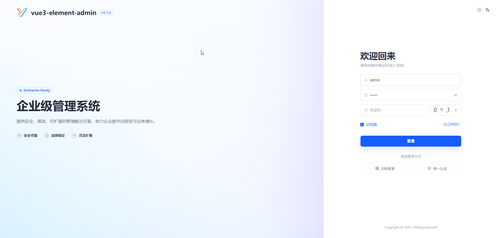
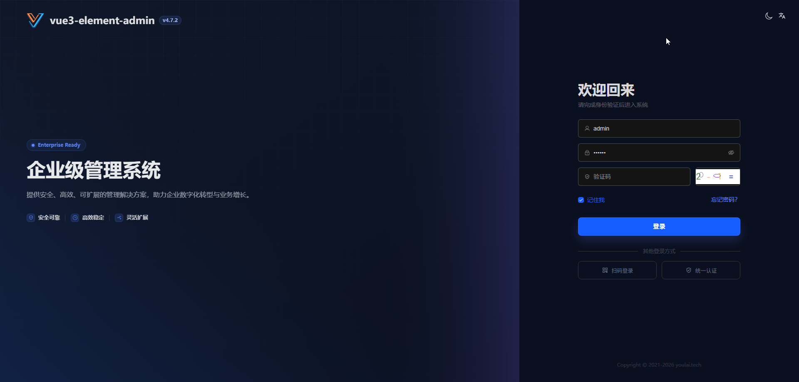
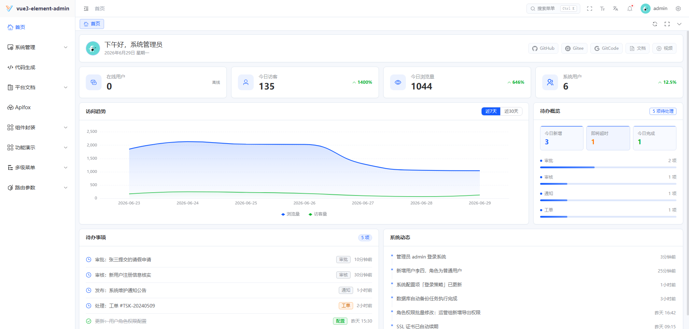
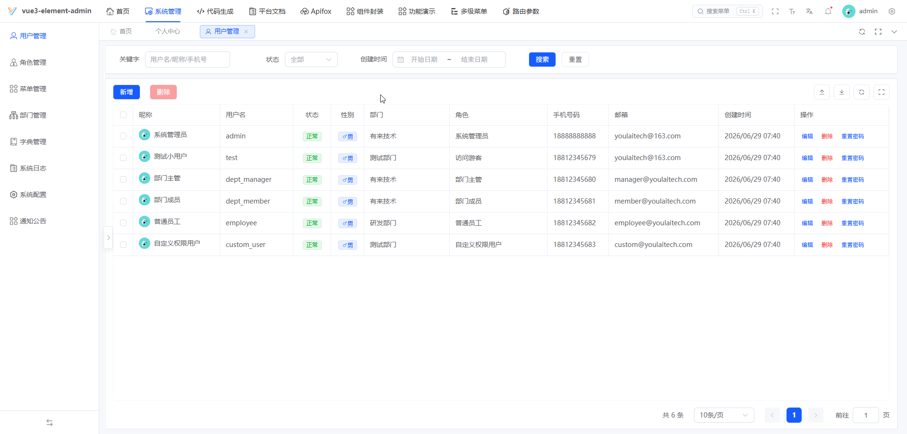
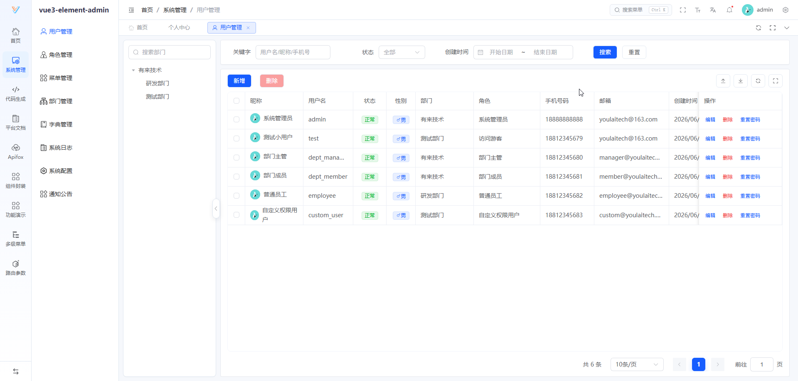
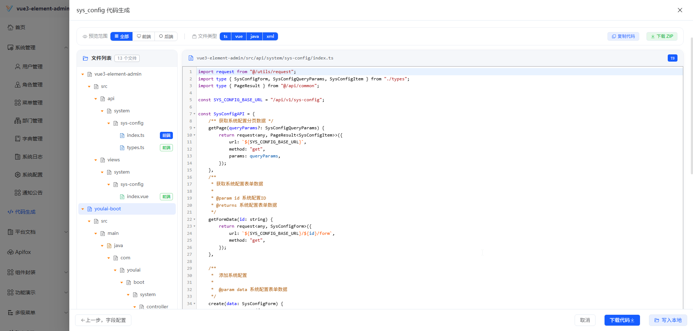
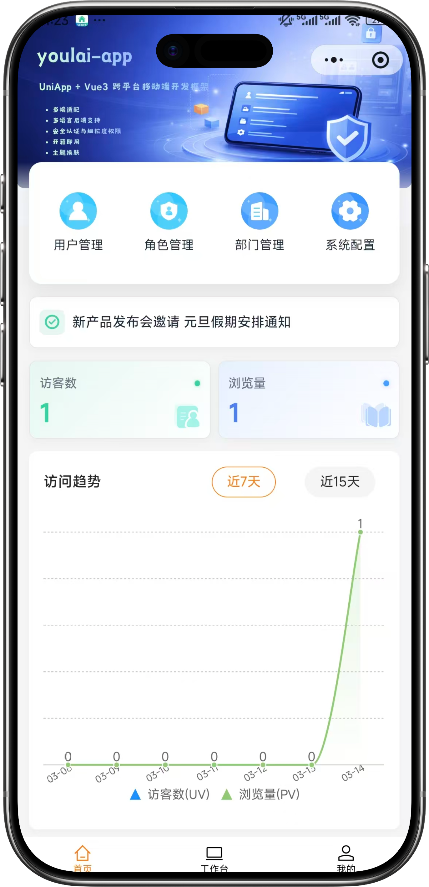
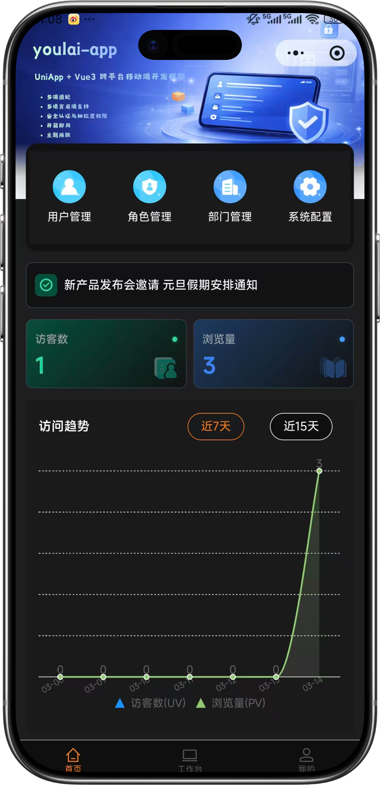
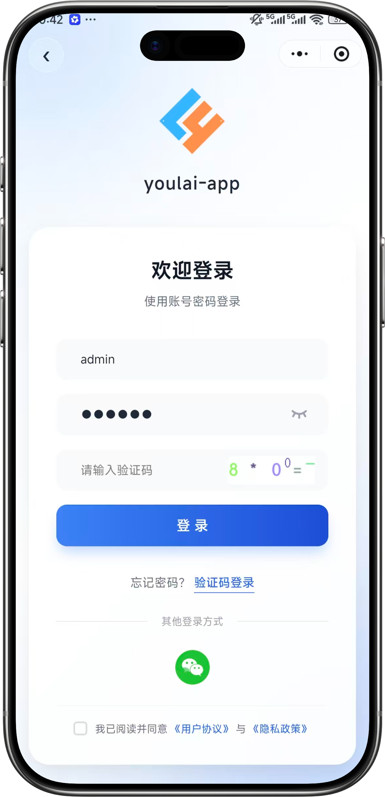
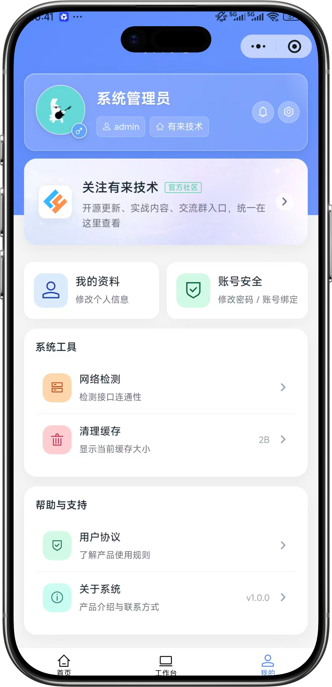

<div align="center">

#  youlai-aspnet

[English](./README.en.md) · [简体中文](./README.md)

**Enterprise-grade permission management backend based on ASP.NET Core 10**

[](https://dotnet.microsoft.com/)
[](LICENSE)
[](https://gitee.com/youlaiorg/youlai-aspnet/stargazers)
[](https://github.com/youlaitech/youlai-aspnet)
[](https://gitcode.com/youlai/youlai-aspnet/stargazers)

</div>


<div align="center">

[🖥️ Live Preview](https://vue.youlai.tech) | [📱 Mobile Preview](https://app.youlai.tech) | [📖 Documentation](https://www.youlai.tech/docs/server/aspnet-core/)

</div>

## Introduction

**youlai-aspnet** is an enterprise-grade permission management backend built on ASP.NET Core 10. It ships with the frontend [vue3-element-admin](https://gitee.com/youlaiorg/vue3-element-admin) and the mobile app [youlai-app](https://gitee.com/youlaiorg/youlai-app), and is one of **7 language implementations** (Java / Node.js / Go / Python / PHP / C# / Rust) that share the same API specification and database schema. It is suitable for learning, reference, and secondary development of enterprise admin systems.

## Core Features

- 🔐 **Security** — JWT + Redis Token dual-session model, token renewal, multi-device mutual exclusion
- 🛡️ **Fine-grained permissions** — RBAC model governing menus, buttons, and APIs in one place
- ⚡ **Code generator** — one-click generation of full-stack CRUD code
- 📦 **Complete modules** — users, roles, menus, departments, dictionaries, files, message center, operation logs
- 🔌 **Real-time communication** — SSE push: online user count, dictionary sync, notification broadcast

## System Preview

**PC**

<table align="center">
  <tr>
    <td></td>
    <td></td>
  </tr>
  <tr>
    <td></td>
    <td></td>
  </tr>
  <tr>
    <td></td>
    <td></td>
  </tr>
</table>

**Mobile**

<table align="center">
  <tr>
    <td></td>
    <td></td>
    <td></td>
    <td></td>
  </tr>
</table>

## Quick Start

**Requirements**: .NET SDK 10+ · MySQL 8.0+ · Redis 7.x+

1. Clone: `git clone https://gitee.com/youlaiorg/youlai-aspnet.git`
2. Import database: `sql/mysql/youlai_admin.sql`
3. Adjust config (optional, a read-only online data source is configured by default): `src/Youlai.Api/appsettings.Development.json`
4. Start: `dotnet run --project src/Youlai.Api`, then visit http://localhost:8000/swagger

Default credentials: `admin` / `123456`

Detailed guide: [Deployment Docs](https://www.youlai.tech/docs/server/aspnet-core/deploy)

## Tech Stack

| Tech | Version | Description |
|:-----|:--------|:------------|
| .NET | 10 | Core framework |
| ASP.NET Core | 10 | Web framework |
| EF Core | 10 | ORM |
| MySQL | 5.7+ / 8.x | Database |
| Redis | 7.x+ | Cache · Session |
| Swagger | — | API docs |
| MinIO | — | Object storage |

## Directory Structure

```
youlai-aspnet/
├── src/
│   ├── Youlai.Api/                     # Web API layer (controllers, middleware, auth)
│   │   ├── Controllers/               # Controllers (Auth/Codegen/File/Message/System)
│   │   ├── Middlewares/               # Middleware
│   │   ├── Security/                  # Security & authentication
│   │   └── Program.cs                 # Application entry
│   ├── Youlai.Application/            # Application layer (DTO, service interfaces, business logic)
│   ├── Youlai.Domain/                 # Domain layer (entities, enums)
│   └── Youlai.Infrastructure/        # Infrastructure layer (EF Core, repositories, cache)
├── sql/                                # Database init scripts
├── tests/                              # Test projects
└── youlai-aspnet.sln                   # Solution file
```

## Ecosystem

**Frontend**

| Project | Stack | Description |
|:-----|:------|:------------|
| [vue3-element-admin](https://gitee.com/youlaiorg/vue3-element-admin) | Vue 3 + Element Plus | PC admin frontend (recommended) |
| [youlai-app](https://gitee.com/youlaiorg/youlai-app) | Vue 3 + UniApp | Mobile App |

**Backend**

| Project | Stack | Description |
|:-----|:------|:------------|
| [youlai-boot](https://gitee.com/youlaiorg/youlai-boot) | Spring Boot + MyBatis-Plus | Java (recommended) |
| [youlai-nest](https://gitee.com/youlaiorg/youlai-nest) | NestJS + TypeORM | Node.js |
| [youlai-gin](https://gitee.com/youlaiorg/youlai-gin) | Go + Gorm | Go |
| [youlai-django](https://gitee.com/youlaiorg/youlai-django) | Django + DRF | Python |
| [youlai-fastapi](https://gitee.com/youlaiorg/youlai-fastapi) | FastAPI + SQLAlchemy | Python |
| [youlai-think](https://gitee.com/youlaiorg/youlai-think) | ThinkPHP + ThinkORM | PHP |
| [youlai-aspnet](https://gitee.com/youlaiorg/youlai-aspnet) | ASP.NET Core + EF Core | C# |
| [youlai-axum](https://gitee.com/youlaiorg/youlai-axum) | Axum + SeaORM | Rust |
> **youlai-boot** also provides the following variants and branches: [Multi-Tenant](https://gitee.com/youlaiorg/youlai-boot-tenant) · [MyBatis-Flex](https://gitee.com/youlaiorg/youlai-boot-flex) · [Spring Boot 3](https://gitee.com/youlaiorg/youlai-boot/tree/spring-boot-3) · [PostgreSQL](https://gitee.com/youlaiorg/youlai-boot/tree/db-pg) · [Multi-Module](https://gitee.com/youlaiorg/youlai-boot/tree/multi-module)
>
> The eight backends share the same **RESTful API specification** and **database schema**, so the frontend can switch seamlessly.

## Documentation

| Resource | Link |
|:-----|:-----|
| 📖 Full docs site | [www.youlai.tech](https://www.youlai.tech/) |
| 🖥️ PC live preview | [vue.youlai.tech](https://vue.youlai.tech) |
| 📱 Mobile live preview | [app.youlai.tech](https://app.youlai.tech) |
| 🔗 Apifox API docs | [apifox.com](https://www.apifox.cn/apidoc/shared-195e783f-4d85-4235-a038-eec696de4ea5) |
| 🔗 Local API docs | [localhost:8000/swagger](http://localhost:8000/swagger) |

## Contributing

Issues and Pull Requests are welcome! See the [Contribution Guide](https://www.youlai.tech/faq/help).

## License

Released under the [Apache License 2.0](LICENSE); free for commercial use.

---

<table align="center">
  <tr>
    <td align="center">
      <br>
      <sub>Official WeChat Account</sub>
    </td>
    <td>&nbsp;&nbsp;&nbsp;&nbsp;</td>
    <td align="center">
      <br>
      <sub>Mini Program</sub>
    </td>
    <td>&nbsp;&nbsp;&nbsp;&nbsp;</td>
    <td align="center">
      <br>
      <sub>Add author on WeChat</sub>
    </td>
  </tr>
</table>

<p align="center"><em>Technical discussion · Feedback · Business cooperation</em></p>
