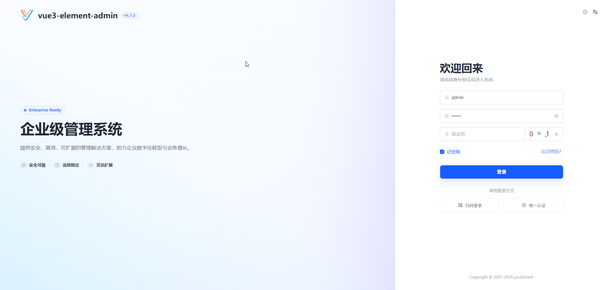
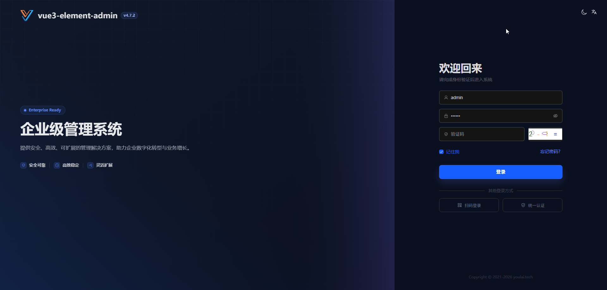
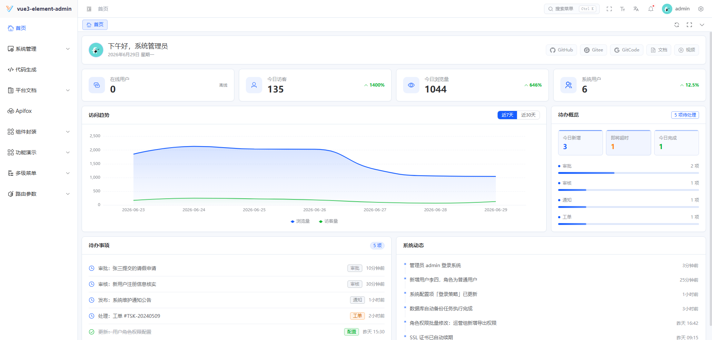
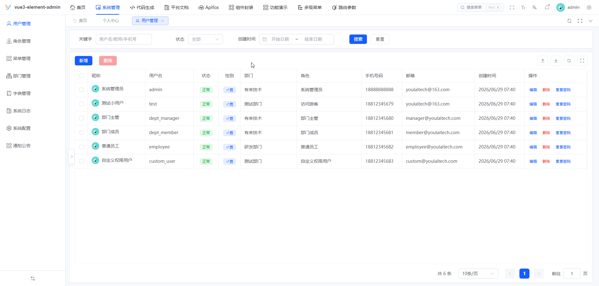
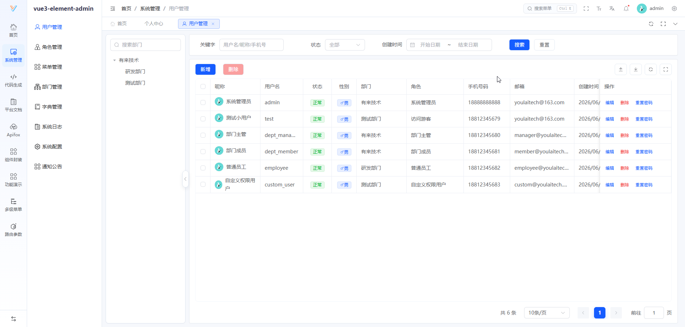
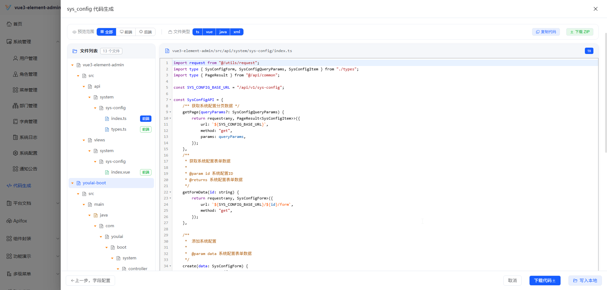
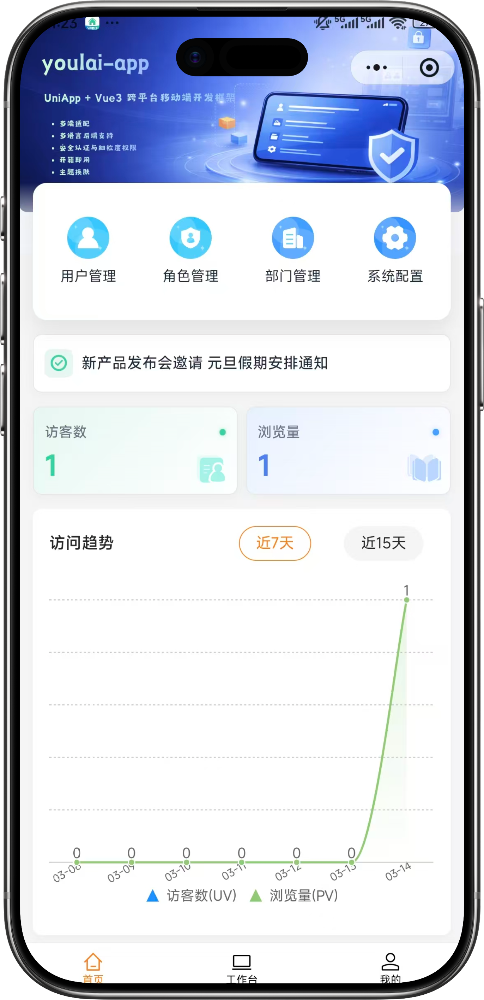
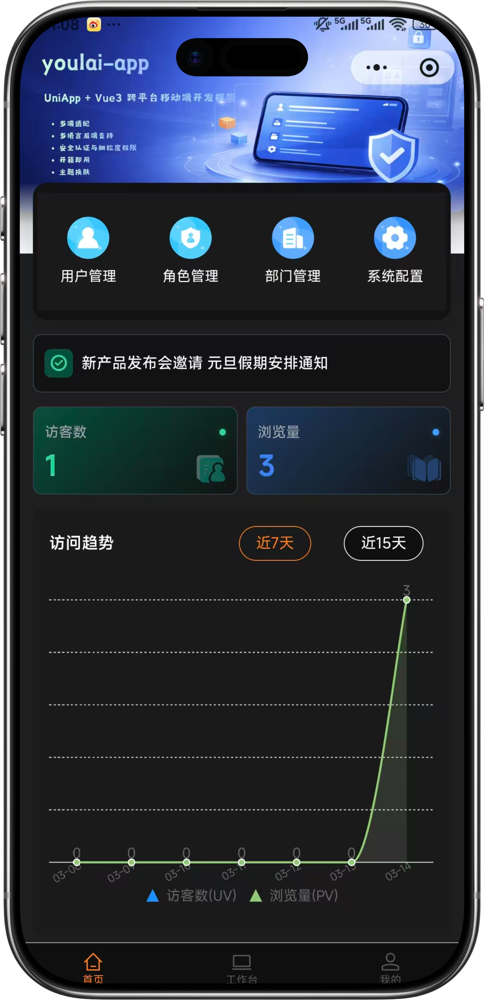
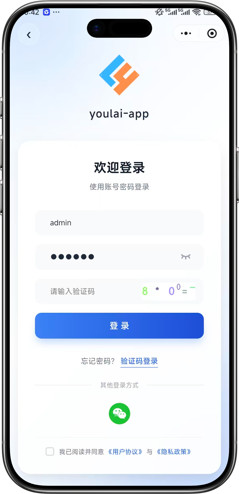
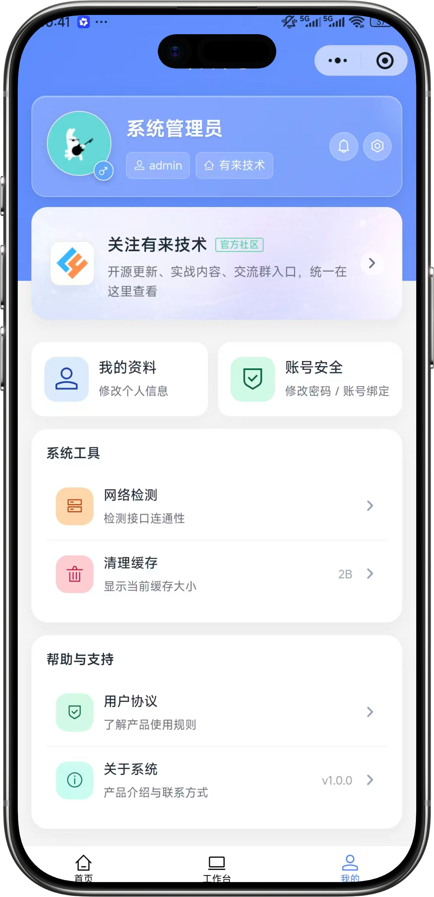

<div align="center">

#  youlai-aspnet

**C# + .NET 10 企业级权限管理系统后端**

<br>

[](https://dotnet.microsoft.com/)
[](LICENSE)
[](https://gitee.com/youlaiorg/youlai-aspnet/stargazers)
[](https://github.com/youlaitech/youlai-aspnet)
[](https://gitcode.com/youlai/youlai-aspnet/stargazers)

</div>

<p align="center"></p>

<div align="center">

[](https://admin.youlai.tech)
[](https://app.youlai.tech)
[](https://www.youlai.tech/docs/server/spring-boot/)
[](./README.en.md)

</div>

## 项目简介

**youlai-aspnet** 是一套基于 ASP.NET Core 10 的企业级权限管理系统后端，配套前端 [vue3-element-admin](https://gitee.com/youlaiorg/vue3-element-admin) 和移动端 [youlai-app](https://gitee.com/youlaiorg/youlai-app)，并提供 **7 种语言实现**（Java / Node.js / Go / Python / PHP / C# / Rust），共享同一套 API 规范与数据库结构。适用于企业中后台管理系统的学习参考与二次开发。

## 核心特性

- 🔐 **安全体系** — JWT + Redis Token 双会话模式、令牌续期、多端互斥
- 🛡️ **细粒度权限** — RBAC 权限模型，菜单/按钮/接口统一治理
- ⚡ **代码生成器** — 一键生成前后端 CRUD 代码
- 📦 **模块齐全** — 用户、角色、菜单、部门、字典、文件、消息中心、操作日志
- 🔌 **实时通信** — WebSocket 推送：在线用户数、字典同步、通知广播

## 系统预览

**PC 端**

<table align="center">
  <tr>
    <td></td>
    <td></td>
  </tr>
  <tr>
    <td></td>
    <td></td>
  </tr>
  <tr>
    <td></td>
    <td></td>
  </tr>
</table>

**移动端**

<table align="center">
  <tr>
    <td></td>
    <td></td>
    <td></td>
    <td></td>
  </tr>
</table>

## 快速开始

**环境要求**：.NET SDK 10+ · MySQL 8.0+ · Redis 7.x+

1. 克隆项目：`git clone https://gitee.com/youlaiorg/youlai-aspnet.git`
2. 导入数据库：`sql/mysql/youlai_admin.sql`
3. 修改配置（可选，默认已配置线上只读数据源）：`src/Youlai.Api/appsettings.Development.json`
4. 启动服务：

   **方式一：Rider 启动（推荐）**
   用 Rider 打开解决方案，等待还原完成后点击 `Youlai.Api` 的运行配置即可。

   **方式二：命令行启动**
   ```bash
   dotnet run --project src/Youlai.Api
   ```
   启动后访问 [http://localhost:8000/swagger](http://localhost:8000/swagger)，能打开接口文档即说明后端已正常运行。

5. 启动前端（可选）：
   如需可视化操作界面，启动配套前端 [vue3-element-admin](https://gitee.com/youlaiorg/vue3-element-admin)，访问 [http://localhost:3000](http://localhost:3000)，使用 `admin` / `123456` 登录。

> 更多内容详见官方文档：[快速开始](https://www.youlai.tech/docs/server/aspnet-core/quick-start.html) · [部署指南](https://www.youlai.tech/docs/server/aspnet-core/deploy.html)

## 目录结构

```
youlai-aspnet/
├── src/
│   ├── Youlai.Api/                     # Web API 层（控制器、中间件、认证授权）
│   │   ├── Controllers/               # 控制器（Auth/Codegen/File/Message/System）
│   │   ├── Middlewares/               # 中间件
│   │   ├── Security/                  # 安全认证
│   │   └── Program.cs                 # 应用入口
│   ├── Youlai.Application/            # 应用层（DTO、服务接口、业务逻辑）
│   ├── Youlai.Domain/                 # 领域层（实体、枚举）
│   └── Youlai.Infrastructure/        # 基础设施层（EF Core、仓储、缓存）
├── sql/                                # 数据库初始化脚本
├── tests/                              # 测试项目
└── youlai-aspnet.sln                   # 解决方案文件
```

## 生态矩阵

**前端**

| 项目 | 技术栈 | 说明 | 更新状态 |
|:-----|:-------|:-----|:---------|
| [vue3-element-admin](https://gitee.com/youlaiorg/vue3-element-admin) | Vue 3 + Element Plus | PC 管理前端（主推） | ✅️ |
| [youlai-app](https://gitee.com/youlaiorg/youlai-app) | Vue 3 + UniApp | 移动端 App | ✅️ |

**后端**

| 项目 | 技术栈 | 说明 | 更新状态 |
|:-----|:-------|:-----|:---------|
| [youlai-boot](https://gitee.com/youlaiorg/youlai-boot) | Spring Boot + MyBatis-Plus | Java（主推） | ✅️ |
| [youlai-nest](https://gitee.com/youlaiorg/youlai-nest) | NestJS + TypeORM | Node.js | ✅️ |
| [youlai-gin](https://gitee.com/youlaiorg/youlai-gin) | Go + Gorm | Go | ✅️ |
| [youlai-django](https://gitee.com/youlaiorg/youlai-django) | Django + DRF | Python | ✅️ |
| [youlai-fastapi](https://gitee.com/youlaiorg/youlai-fastapi) | FastAPI + SQLAlchemy | Python | ✅️ |
| [youlai-think](https://gitee.com/youlaiorg/youlai-think) | ThinkPHP + ThinkORM | PHP | ✅️ |
| [youlai-aspnet](https://gitee.com/youlaiorg/youlai-aspnet) | ASP.NET Core + EF Core | C# | ✅️ |
| [youlai-axum](https://gitee.com/youlaiorg/youlai-axum) | Axum + SeaORM | Rust | ✅️ |
| [youlai-laravel](https://gitee.com/youlaiorg/youlai-laravel) | Laravel + Eloquent | PHP | ❌️ |

> 九种后端共享同一套 **RESTful API 规范** 和 **数据库结构**，前端可无缝切换。

**衍生版本**

| 项目 | 基于 | 类型 | 说明 | 更新状态 |
|:-----|:-----|:-----|:-----|:---------|
| [youlai-boot-tenant](https://gitee.com/youlaiorg/youlai-boot-tenant) | youlai-boot | 独立仓库 | 多租户 SaaS，租户隔离与租户配置 | ✅️ |
| [youlai-boot-flex](https://gitee.com/youlaiorg/youlai-boot-flex) | youlai-boot | 独立仓库 | 改用 MyBatis-Flex | ✅️ |
| [youlai-boot (db-pg)](https://gitee.com/youlaiorg/youlai-boot/tree/db-pg) | youlai-boot | 分支 | PostgreSQL 数据库分支 | ✅️ |
| [youlai-boot (multi-module)](https://gitee.com/youlaiorg/youlai-boot/tree/multi-module) | youlai-boot | 分支 | 多模块工程拆分 | ✅️ |
| [youlai-nest (multi-tenant)](https://gitee.com/youlaiorg/youlai-nest/tree/multi-tenant) | youlai-nest | 分支 | 多租户 SaaS，租户隔离与租户配置 | ✅️ |
| [youlai-boot (spring-boot-3)](https://gitee.com/youlaiorg/youlai-boot/tree/spring-boot-3) | youlai-boot | 分支 | Spring Boot 3 兼容分支 | ❌️ |

## 可选扩展

**AI 辅助（默认关闭）**：`appsettings.Development.json` 的 `Ai` 段打开开关并填写密钥，接口为 OpenAI 兼容协议。

```json
"Ai": {
  "Enabled": true,
  "ApiKey": "sk-xxx"
}
```

**代码生成菜单（生产关闭）**：`Codegen:CreateMenu` 控制保存生成配置时是否自动创建页面菜单与增删改查按钮，默认开启，`appsettings.Production.json` 中已关闭。

## 技术合作

本项目采用 [Apache License 2.0](LICENSE) 开源，可免费商用。欢迎在 [Issue](https://gitee.com/youlaiorg/youlai-aspnet/issues) 提交问题或反馈，也欢迎提交 [Pull Request](https://gitee.com/youlaiorg/youlai-aspnet/pulls) 共建。

如需技术支持、商务合作、二次开发、项目定制或私有化部署，可联系作者微信（见下方二维码）。

<table align="center">
  <tr>
    <td align="center">
      <br>
      <sub>公众号「有来技术」</sub>
    </td>
    <td>&nbsp;&nbsp;&nbsp;&nbsp;</td>
    <td align="center">
      <br>
      <sub>小程序「有来技术」</sub>
    </td>
    <td>&nbsp;&nbsp;&nbsp;&nbsp;</td>
    <td align="center">
      <br>
      <sub>添加作者微信</sub>
    </td>
  </tr>
</table>

<p align="center"><em>技术交流 · 问题反馈 · 商务合作</em></p>
